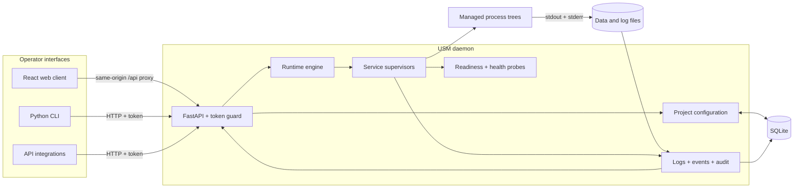
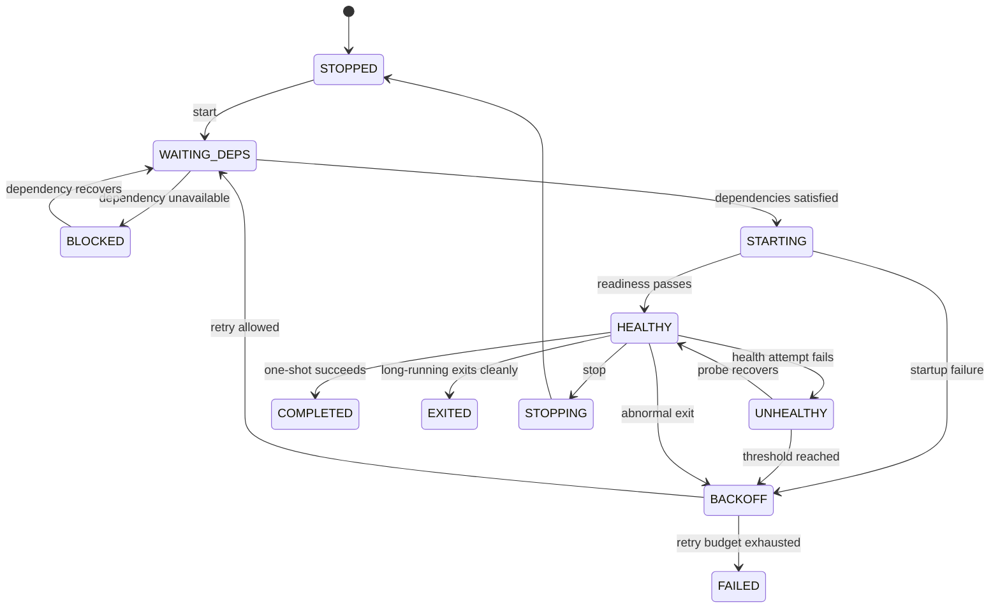

# Universal Service Manager (USM)

### A local-first, technology-agnostic supervisor for the services that make up your application

<p align="center">
  
</p>
<p align="center">
  <em>One workspace for project health, process state, resource usage, logs, and service control.</em>
</p>

<p align="center">
  <a href="#gallery"><strong>Gallery</strong></a> ·
  <a href="#product-capabilities">Capabilities</a> ·
  <a href="#architecture">Architecture</a> ·
  <a href="#quick-start"><strong>Quick start</strong></a> ·
  <a href="#security-boundary">Security</a>
</p>

Universal Service Manager—also referred to by the repository name **Universal Service Monitor**—runs the related programs behind an application as one supervised project. A project can contain Python APIs, Node.js clients, compiled binaries, workers, databases, or any other operating-system command.

USM starts those services in dependency order, waits for them to become ready, monitors their health, restarts failures according to policy, captures output, and stops complete process trees. Operators can manage the same local workspace through a browser interface, command-line client, or token-protected REST API.

> **The central idea:** describe the application once; let one local supervisor keep its services ordered, observable, and running.

USM is currently at daemon version **0.2.0**. The core supervision engine, React client, CLI, API, persistence, health checks, recovery, logs, events, and diagnostic tools are implemented. OS service installation, remote fleet management, multi-user authorization, notifications, and production secret management remain future work.

---

## Gallery

The screenshots below show USM supervising the three-service Shah-NVR development stack. Full-resolution images are available in [`gallery/`](gallery/).

<table>
  <tr>
    <td width="33%" align="center" valign="top">
      <a href="gallery/Screenshot%202026-11-07%20223204.png"></a><br>
      <sub><strong>Project workspace</strong><br>Create projects, import YAML, inspect aggregate state, and control the full stack.</sub>
    </td>
    <td width="33%" align="center" valign="top">
      <a href="gallery/Screenshot%202026-11-07%20223216.png"></a><br>
      <sub><strong>Service orchestration</strong><br>See every service, PID, health state, resource use, uptime, and available action.</sub>
    </td>
    <td width="33%" align="center" valign="top">
      <a href="gallery/Screenshot%202026-11-07%20223241.png"></a><br>
      <sub><strong>Live process output</strong><br>Follow a bounded log stream, pause it, clear the view, or download captured output.</sub>
    </td>
  </tr>
  <tr>
    <td width="33%" align="center" valign="top">
      <a href="gallery/Screenshot%202026-11-07%20223256.png"></a><br>
      <sub><strong>Events and audit</strong><br>Trace lifecycle transitions, re-adoption, operator actions, and manager activity.</sub>
    </td>
    <td width="33%" align="center" valign="top">
      <a href="gallery/Screenshot%202026-11-07%20223307.png"></a><br>
      <sub><strong>Configuration tools</strong><br>Check ports, resolve executables, browse directories, and detect likely commands.</sub>
    </td>
    <td width="33%" align="center" valign="top">
      <a href="gallery/Screenshot%202026-11-07%20223320.png"></a><br>
      <sub><strong>Local preferences</strong><br>Control theme, accent, refresh timing, navigation density, and session access.</sub>
    </td>
  </tr>
</table>

---

## Why USM

Development and self-hosted applications often become a collection of terminals, startup scripts, framework-specific process managers, and undocumented service ordering. That works until a process crashes, a port is already occupied, a dependency is late to start, or the person who remembers the correct sequence is unavailable.

USM provides one consistent model:

- **Projects, not loose processes.** Group an application's services, shared environment, working directory, and dependencies.
- **Runtime-neutral commands.** Launch Python, Node.js, Rust, Go, Java, native binaries, or shell commands without a framework adapter.
- **Dependency-aware startup.** Gate a service on another service being started, healthy, or successfully completed.
- **Observable readiness and health.** Use TCP, HTTP, process, log-regex, or delay probes where they fit.
- **Controlled failure recovery.** Apply restart budgets and backoff instead of uncontrolled restart loops.
- **Real process-tree ownership.** Stop the descendants created by a service, not only its first PID.
- **Manager-independent children.** By default, services continue when USM exits and are re-adopted when it returns.
- **One local control plane.** Use the web UI, CLI, or API against the same validated configuration and runtime state.

USM is intentionally local-first. It supervises commands on the machine where it runs; it is not a remote container scheduler or a distributed fleet controller.

---

## Product capabilities

### Project and dependency orchestration

- Strict project configuration through the UI, JSON API, or YAML import/export.
- Directed dependency graph with cycle, duplicate, and unknown-reference validation.
- Dependency conditions: `started`, `healthy`, and `completed`.
- Topological startup and reverse-order shutdown.
- Full-project or selected-service start, stop, and restart actions.
- Long-running and one-shot service kinds.
- Project- and service-level working directories, environment files, and explicit environment values.
- Optional autostart intent when USM detects a new operating-system boot.

### Process supervision and recovery

- Immediate process-exit monitoring.
- Restart modes: `never`, `on_failure`, and `always`.
- Configurable retry window, maximum attempts, and backoff sequence.
- Graceful stop followed by a bounded forceful process-tree cleanup.
- Force-kill and reset actions for individual services.
- Persistent desired state and process identity.
- PID and creation-time validation before re-adopting a surviving process.
- Process-tree CPU, memory, child-count, uptime, PID, and restart statistics.

### Readiness and health

| Probe                  | Readiness | Ongoing health | Typical use                    |
| ---------------------- | :-------: | :------------: | ------------------------------ |
| TCP                    |    Yes    |      Yes       | Wait for a local listener      |
| HTTP                   |    Yes    |      Yes       | Verify an application endpoint |
| Process                |    Yes    |      Yes       | Confirm process survival       |
| Log regular expression |    Yes    |       —        | Detect a startup message       |
| Delay                  |    Yes    |       —        | Allow a fixed warm-up period   |

Local TCP and HTTP probe ports are checked before spawn to catch common port conflicts early. Health checks support attempt timeouts, intervals, start periods, failure thresholds, and expected HTTP statuses.

### Logs and operational history

- Merged stdout/stderr written directly to per-service files.
- Output continues while the manager is temporarily offline.
- Copy-truncate rotation with configurable size and file count.
- Bounded in-memory log buffer with tail and sequence-based reads.
- Live browser and CLI following with manager-restart cursor recovery.
- Persistent lifecycle events with project/service filtering.
- Audit history for configuration and operator actions.
- Rotating manager log for daemon-level diagnostics.

### Operator interfaces

| Interface      | Technology                                            | Best fit                                                 |
| -------------- | ----------------------------------------------------- | -------------------------------------------------------- |
| **Web client** | React, TypeScript, Vite, TanStack Query, Tailwind CSS | Visual setup, monitoring, logs, actions, and diagnostics |
| **CLI**        | Python and httpx                                      | Local terminals, scripts, and fast operational workflows |
| **REST API**   | FastAPI and Pydantic                                  | Integrations and custom tooling                          |

The web client includes protected routing, token login, project/service configuration, YAML import/export, logs, events, audit history, diagnostics, responsive mobile navigation, centralized themes, and an explicit offline demo mode. Demo data never replaces a failed live connection.

---

## Architecture

USM separates validated configuration, runtime coordination, per-service supervision, and platform-specific process ownership.



### Daemon and API

`service_manager/main.py` composes FastAPI, the SQLite-backed configuration store, runtime engine, event writer, single-instance guard, and hang watchdog. The API validates every project through one canonical `ProjectSpec` used by JSON, YAML, persistence, and runtime application.

The default address is `http://127.0.0.1:7420`. Protected routes accept `X-USM-Token` or a bearer token. The generated token is stored in `service_manager/data/token`.

### Runtime engine

One engine owns every loaded project. Each project builds a supervisor for every configured service. Supervisors wait for dependency conditions, resolve commands and environments, start platform process trees, run probes, apply restart policy, and publish current state.

### Platform process layer

| Concern             | Windows                                           | POSIX                                       |
| ------------------- | ------------------------------------------------- | ------------------------------------------- |
| Process containment | Named Job Object plus descendant sweep            | New session/process group                   |
| Graceful stop       | Console Ctrl+C attempt                            | `SIGTERM` to process group                  |
| Force stop          | Terminate Job Object/tree                         | `SIGKILL` to process group/tree             |
| Recovery            | PID/start-time validation and Job Object recovery | PID/start-time and process-group validation |

USM launches direct argument lists by default. Shell strings require the explicit `shell: true` setting. On Windows, common `npm` and `npx` shims are resolved without requiring every service definition to invoke `cmd.exe` manually.

### Persistence

SQLite stores project configuration, desired runtime state, process identity, events, and audit history. Live process handles, observed state, active retry windows, and log buffers remain runtime-owned. YAML is an interchange format rather than a continuously watched configuration file.

For a detailed backend review, see [`docs/architecture.md`](docs/architecture.md). The browser architecture and extension guide are documented in [`client/docs/ARCHITECTURE.md`](client/docs/ARCHITECTURE.md).

---

## Service lifecycle



Project state is derived from its services. A failed, unhealthy, blocked, or backing-off service makes the project degraded; startup and shutdown make it transitional; otherwise it reports running or stopped according to the aggregate state.

---

## Configuration example

The project specification is deliberately readable and version-control friendly:

```yaml
id: example-stack
name: Example stack
description: API and browser client
cwd: D:/Projects/example-stack
autostart: false

services:
  - id: api
    command: [.venv/Scripts/python.exe, main.py]
    cwd: api
    readiness:
      type: http
      url: http://127.0.0.1:8000/health
      timeout_s: 60
    health_checks:
      - type: http
        url: http://127.0.0.1:8000/health
        interval_s: 10
        failures: 3
    restart_policy:
      mode: on_failure
      max: 5
      window_s: 600
      backoff: [1, 2, 5, 15, 30]

  - id: web
    command: [npm, run, dev]
    cwd: web
    depends_on:
      - id: api
        condition: healthy
    readiness:
      type: tcp
      port: 5156
      timeout_s: 60
```

Use an absolute project `cwd`; relative service directories resolve beneath it. On POSIX, change the interpreter path to the corresponding virtual-environment executable, such as `.venv/bin/python`.

A complete three-service configuration is available at [`examples/shah-nvr.usm.yaml`](examples/shah-nvr.usm.yaml).

---

## Repository map

```text
Universal-Service-Monitor/
├── service_manager/       FastAPI daemon, CLI, supervision engine, persistence
│   ├── app/               Projects, runtime, processes, health, logs, events, tools
│   ├── database/          Tortoise ORM configuration
│   ├── settings/          Environment and data-path settings
│   ├── tests/             Schema, API, launch, and real-process tests
│   ├── main.py            Daemon entry point
│   ├── cli.py             Token-authenticated command-line client
│   └── usm.cmd            Windows CLI convenience wrapper
├── client/                React/TypeScript production client
│   ├── src/api/           Typed HTTP transport and domain services
│   ├── src/features/      Login, configuration, logs, and diagnostics
│   ├── src/pages/         Route-level screens
│   ├── src/styles/        Centralized design tokens and global styles
│   └── tests/             Unit and Playwright browser tests
├── client-static/         Preserved original UI prototype
├── examples/              Importable project definitions
├── gallery/               Product screenshots
├── docs/                  Architecture and design documentation
└── LICENSE                MIT license
```

### Technology stack

| Layer              | Technologies                                                           |
| ------------------ | ---------------------------------------------------------------------- |
| Daemon API         | Python, FastAPI, Uvicorn, Pydantic v2                                  |
| Persistence        | SQLite, Tortoise ORM, Aerich configuration                             |
| Supervision        | asyncio, psutil, pywin32 on Windows, POSIX signals/process groups      |
| Probe and API HTTP | httpx                                                                  |
| Configuration      | YAML and JSON                                                          |
| Web client         | React 19, TypeScript, Vite, TanStack Query, React Router, Tailwind CSS |
| UI testing         | Vitest and Playwright                                                  |
| Backend testing    | pytest and pytest-asyncio                                              |

---

## Quick start

### Prerequisites

- Python 3.10 or newer; a current supported Python release is recommended.
- Node.js 22.12 or newer for the web client.
- Windows or a POSIX system such as Linux for the daemon.
- The runtimes and dependencies required by the services you plan to supervise.

### 1. Install and start the manager

Windows PowerShell:

```powershell
cd service_manager
py -m venv .venv
.\.venv\Scripts\python.exe -m pip install -r requirements.txt
.\.venv\Scripts\python.exe main.py
```

Linux/macOS shell:

```bash
cd service_manager
python3 -m venv .venv
.venv/bin/python -m pip install -r requirements.txt
.venv/bin/python main.py
```

The manager creates its SQLite database, API token, logs, and runtime directories automatically. The default endpoints are:

- API: `http://127.0.0.1:7420`
- Interactive API documentation: `http://127.0.0.1:7420/docs`
- Token file: `service_manager/data/token`

Keep this daemon terminal running while using the UI or CLI. Supervised children continue running by default if the manager exits.

### 2. Start the web client

In a second terminal:

```powershell
cd client
npm install
npm run dev
```

Open `http://127.0.0.1:5156` and sign in with the contents of `service_manager/data/token`. The development server proxies `/api` to the local daemon, so the browser does not require backend CORS changes.

The token remains in memory unless **Remember for this tab** is selected. That option uses tab-scoped `sessionStorage`; USM never stores the token in a URL or `localStorage`.

### 3. Create a project

Use **New project** or **Import YAML** in the browser, or import the included example through the CLI after adapting its paths:

```powershell
cd service_manager
.\usm import ..\examples\shah-nvr.usm.yaml
.\usm up shah-nvr --wait
.\usm status
.\usm logs shah-nvr central-manager -f
.\usm down shah-nvr
```

`usm.cmd` prefers `service_manager/.venv` automatically. You can also use `.\.venv\Scripts\python.exe cli.py <command>`.

---

## CLI reference

| Command                                   | Purpose                                                           |
| ----------------------------------------- | ----------------------------------------------------------------- |
| `usm status [project]`                    | Show projects, service states, PIDs, uptime, and restart counts   |
| `usm ls`                                  | List saved projects and aggregate state                           |
| `usm import <file> [--restart]`           | Create or update a project from YAML                              |
| `usm export <project>`                    | Export the canonical project YAML                                 |
| `usm up <project> [services...] [--wait]` | Start a project or selected services and dependencies             |
| `usm down <project> [services...]`        | Stop a project or selected services                               |
| `usm restart <project> [services...]`     | Restart a project or selected services                            |
| `usm kill <project> <service>`            | Force-kill a service tree without changing desired running intent |
| `usm reset <project> <service>`           | Restart a service with a cleared retry window                     |
| `usm logs <project> <service> -f`         | Read or follow captured output                                    |
| `usm events`                              | Inspect recent lifecycle events                                   |
| `usm rm <project>`                        | Stop and delete a project                                         |
| `usm resolve <command>`                   | Resolve an executable as the manager sees it                      |
| `usm port <number>`                       | Inspect a local TCP listener                                      |

Run `usm --help` or `usm <command> --help` for complete options.

---

## API surface

All protected routes are under `/api/v1` and accept `X-USM-Token` or `Authorization: Bearer <token>`.

| Method and path                                             | Purpose                                                    |
| ----------------------------------------------------------- | ---------------------------------------------------------- |
| `GET /health`                                               | Public daemon liveness                                     |
| `GET /status?stats=true`                                    | Project/service state and optional process-tree statistics |
| `GET`, `POST /projects`                                     | List or create projects                                    |
| `GET`, `PUT`, `DELETE /projects/{id}`                       | Read, replace, or stop and delete a project                |
| `POST /projects/import`                                     | Import a raw YAML project                                  |
| `GET /projects/{id}/export`                                 | Export canonical YAML                                      |
| `POST /projects/{id}/actions`                               | Start, stop, or restart a project/service subset           |
| `GET /projects/{id}/services/{sid}`                         | Service configuration and live detail                      |
| `POST /projects/{id}/services/{sid}/actions`                | Start, stop, restart, kill, or reset one service           |
| `GET /projects/{id}/services/{sid}/logs`                    | Tail or sequence-read service logs                         |
| `GET /events`, `GET /audit`                                 | Lifecycle history and operator audit                       |
| `/tools/resolve-exe`, `/check-port`, `/list-dir`, `/detect` | Local configuration diagnostics                            |

The browser integration map is maintained in [`client/docs/API.md`](client/docs/API.md).

---

## Configuration and data

The daemon reads `service_manager/.env` and process environment variables.

| Setting                  | Default                | Purpose                                                                   |
| ------------------------ | ---------------------- | ------------------------------------------------------------------------- |
| `HOST`                   | `127.0.0.1`            | API bind address                                                          |
| `PORT`                   | `7420`                 | API port                                                                  |
| `LOG_LEVEL`              | `INFO`                 | Manager log level                                                         |
| `DATA_DIR`               | `service_manager/data` | Database, token, manager log, and service logs                            |
| `DATABASE_URL`           | local SQLite           | Optional Tortoise database URL override                                   |
| `STOP_SERVICES_ON_EXIT`  | `false`                | Stop children during a normal manager shutdown                            |
| `WATCHDOG_STALL_SECONDS` | `60`                   | Terminate a stuck daemon so an OS supervisor can restart it; `0` disables |
| `EVENTS_KEEP`            | `50000`                | Number of recent lifecycle events to retain                               |

Default on-disk layout:

```text
service_manager/data/
├── usm.sqlite3
├── token
├── manager.log
├── manager.lock
└── logs/
    └── <project>/<service>/
        ├── output.log
        └── output.log.1
```

Do not commit this directory. It can contain API credentials, environment values, command metadata, and application output.

---

## Testing and verification

Backend suite:

```powershell
cd service_manager
.\.venv\Scripts\python.exe -m pytest -q
```

The current backend suite contains 45 tests covering validation, command/environment resolution, API integration, lifecycle startup, dependencies, health failures, restart exhaustion, one-shot completion, process-tree cleanup, rotation, recovery, and manual-stop persistence.

Client suite:

```powershell
cd client
npm run typecheck
npm test
npm run build
npm run test:browser
npm run test:live
```

The client currently has 13 unit tests and eight browser workflows. `test:live` starts an isolated temporary manager and verifies token login, project/service creation, a real process start, log capture, events/audit, YAML export, stop, deletion, and cleanup without touching the developer's normal USM data.

See [`client/docs/PROGRESS.md`](client/docs/PROGRESS.md) for the latest client verification ledger.

---

## Security boundary

USM is a **single-user local command-execution service**. Anyone with its API token can start, stop, inspect, or reconfigure processes under the manager's operating-system account.

Current protections include:

- loopback binding by default;
- loopback Host and browser Origin validation;
- cryptographically generated API token with constant-time comparison;
- no credentials in URL query parameters;
- in-memory browser token storage by default; and
- strict project schemas that reject unknown or malformed configuration.

Current limitations are equally important:

- no users, roles, or per-project authorization;
- no built-in TLS termination;
- no per-service operating-system identity or privilege isolation;
- token-file permissions are not explicitly hardened;
- project environment values are stored and exported without encryption or masking; and
- changing `HOST` away from loopback does not turn USM into a hardened remote-control service.

Keep USM on a trusted local machine. Do not expose the API directly to an untrusted network. A production web build must be served through a loopback same-origin reverse proxy that forwards `/api` to the daemon.

---

## Current limitations and roadmap

- The operating system must start USM. Task Scheduler, systemd installation, installers, and automatic upgrade tooling are not included yet.
- The watchdog can terminate a stuck daemon, but only an external OS supervisor can restart it.
- Status and logs use polling; there is no WebSocket or server-sent-event transport.
- USM manages one local host. Remote fleet enrollment and centralized synchronization are not implemented.
- General schedules, automation rules, alert delivery, and notification channels are not implemented.
- Native Docker/container adoption and existing OS-service adoption are outside the current process model.
- A re-adopted POSIX process cannot always provide its eventual exit code, and a grandchild orphaned while the manager is down may not be recoverable.
- Killing the manager with Windows `taskkill /T` also asks Windows to kill its descendants; use normal shutdown or kill only the manager PID when service survival is required.

These boundaries keep the current release focused: reliable local supervision first, broader deployment automation later.

---

## Engineering principles

1. Configuration has one strict canonical model across JSON, YAML, persistence, and runtime.
2. Project dependencies must remain explicit and cycle-free.
3. Process ownership belongs in platform adapters, not HTTP routes or UI code.
4. A service failure must be observable and bounded by policy.
5. Normal manager downtime should not silently terminate healthy child processes.
6. Re-adoption must verify process identity before assuming control of a PID.
7. Logs must not depend on a browser, CLI follower, or manager pipe staying connected.
8. Live API errors must remain visible; demonstration data must never masquerade as real state.
9. Client settings must not pretend to configure daemon capabilities that have no API.
10. The local command-execution security boundary must stay explicit in code and documentation.

---

## Documentation

- [Backend architecture and implementation review](docs/architecture.md)
- [Earlier architecture design](docs/plane_02_architecture.md)
- [UI design notes](docs/ui-design-notes.md)
- [Client setup](client/README.md)
- [Client architecture and resume guide](client/docs/ARCHITECTURE.md)
- [Client API classification](client/docs/API.md)
- [Client task and verification record](client/docs/PROGRESS.md)

---

## License

USM is released under the [MIT License](LICENSE).
