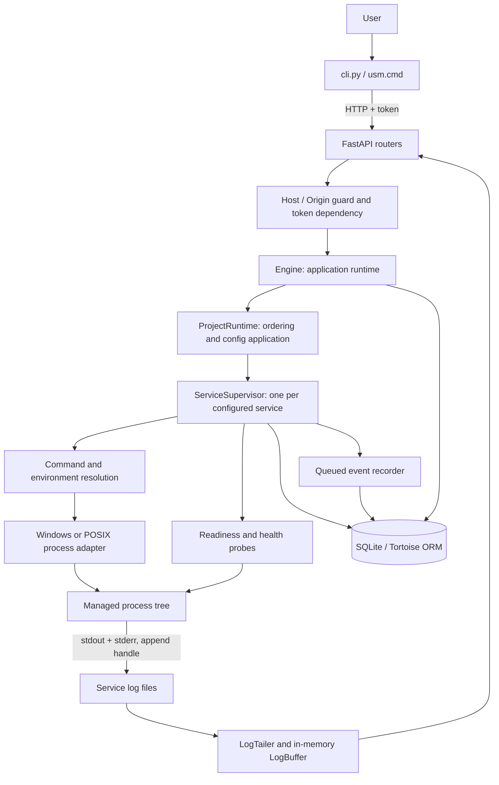
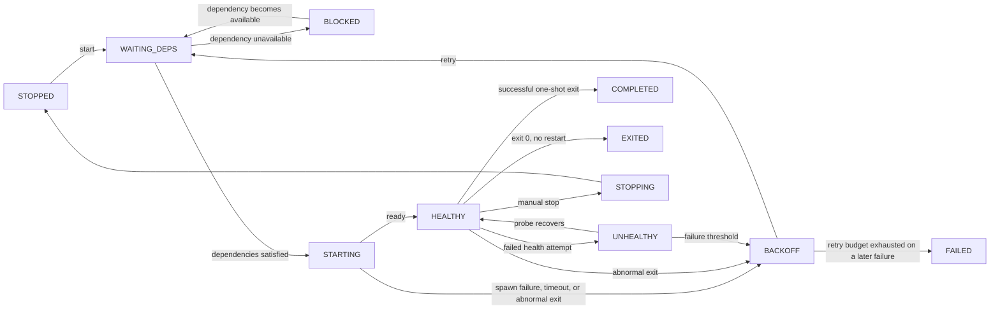
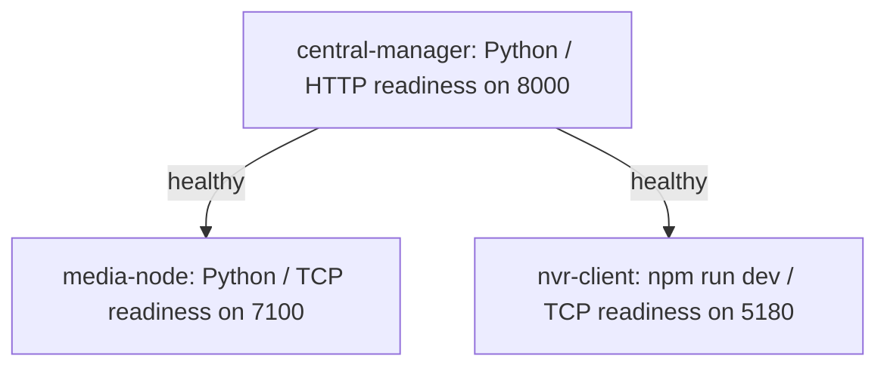

# Universal Service Monitor / Manager (USM): Current Architecture

Reviewed: 2026-11-07. Application version in source: `0.2.0`.

This guide describes the implementation in this repository. The repository is named Universal Service Monitor; the application's configured name, README, and CLI call it **Universal Service Manager (USM)**. They refer to the same project.

The earlier [architecture draft](plane_02_architecture.md) records the intended direction. It includes proposed features and earlier design choices that are not all present in the code. Use this document to understand the current system and the draft for historical design context.

## 1. Purpose and scope

USM is a local, project-oriented process supervisor. A project groups related programs, and each program is configured as a service. USM starts services in dependency order, checks readiness and health, restarts failed processes according to policy, captures logs, and stops process trees.

It can manage different technologies because it launches operating-system commands rather than integrating with each framework. A Python interpreter, Node command, or compiled executable is simply a command plus arguments, working directory, environment, and policies. It does not install those runtimes or application dependencies.

The current product consists of a Python daemon exposing FastAPI REST endpoints, a separate command-line client, and a React/TypeScript browser client in `client/`. The browser uses the existing polling API through a same-origin proxy. There is no remote fleet server, message broker, or WebSocket endpoint in the current implementation.

## 2. System overview



The guard and authentication dependency protect requests before their route handlers perform operations. The diagram groups them together for readability; the guard is application middleware and token verification is attached to routers.

All projects share one engine and event loop in one daemon process. Each service has its own supervisor lifecycle task and log-tailing task. Owned child processes also have a dedicated daemon thread waiting for exit; re-adopted processes are polled. Blocking work such as process-tree termination and some system inspection runs through `asyncio.to_thread`.

The operating system must start/restart the daemon if unattended operation is required. This repository does not yet provide that OS installation layer. The internal watchdog can terminate a hung daemon, but cannot restart it itself.

## 3. Source map and module responsibilities

Paths below are relative to `service_manager/` unless stated otherwise.

| Area | Main files | Responsibility |
|---|---|---|
| Application composition | [`main.py`](../service_manager/main.py) | FastAPI app, lifespan, ORM initialization, engine lifecycle, router registration, error handlers, direct server entry point |
| CLI | [`cli.py`](../service_manager/cli.py), `usm.cmd` | HTTP client, YAML path normalization, status formatting, actions, log polling |
| Settings | [`settings/settings.py`](../service_manager/settings/settings.py) | Environment and `.env` settings, data paths, token creation |
| Database | [`database/config.py`](../service_manager/database/config.py), `pyproject.toml` | Tortoise model registration and Aerich configuration |
| Project configuration | [`app/projects/`](../service_manager/app/projects) | Strict Pydantic specs, relational config storage, transactional save, YAML import/export, CRUD routes |
| Runtime orchestration | [`app/runtime/services.py`](../service_manager/app/runtime/services.py) | `Engine`, `ProjectRuntime`, project actions, recovery, config diff/application |
| Service lifecycle | [`app/runtime/supervisor.py`](../service_manager/app/runtime/supervisor.py) | Dependency gates, spawn, readiness, health monitoring, retry budget, stop and detach |
| Runtime persistence | `app/runtime/models.py`, `utils.py`, `schemas.py` | Desired state and process identity persistence; status/action API schemas |
| Process adapters | [`app/processes/`](../service_manager/app/processes) | Common process handle, Windows Job Objects, POSIX process groups, launch resolution |
| Probes | [`app/health/services.py`](../service_manager/app/health/services.py) | Individual probe attempts and readiness waits |
| Logs | [`app/logs/`](../service_manager/app/logs) | File tailing, ring buffer, copy-truncate rotation, REST log reads |
| Events and audit | [`app/events/`](../service_manager/app/events) | Batched lifecycle event persistence and direct audit writes |
| Configuration helpers | [`app/tools/`](../service_manager/app/tools) | Folder browsing, command suggestions, executable resolution, port ownership |
| Shared utilities | [`utilities/`](../service_manager/utilities) | DAG traversal, async races, clocks, security, instance lock, watchdog |
| Tests | [`tests/`](../service_manager/tests) | Schema, launch, API, lifespan, and real-process integration tests |
| Example configuration | [`examples/shah-nvr.usm.yaml`](../examples/shah-nvr.usm.yaml) | Three-service Shah-NVR project |
| Historical plans | `plane/plane_01.txt`, `docs/plane_02_architecture.md` at repository root | Original fleet proposal and later local-first draft |

The root `codes` file is a command cheat sheet, not application source. Generated data, virtual environments, and caches are runtime/development artifacts.

## 4. Domain model and validation

`ProjectSpec` is the canonical configuration shape. JSON API input, YAML import/export, loaded database configuration, and the runtime use it.

**Project:** slug ID, optional display name, description, `autostart`, base working directory, project environment and optional environment file, and services.

**Service:** project-local slug ID, optional name, `enabled`, `kind`, command, shell flag, working directory, environment/environment file, dependency edges, readiness probe, health checks, health start period, and restart/stop/log policies.

Supported kinds are `long_running` and `one_shot`. There is no required technology/runtime discriminator: the command determines what runs.

Configuration schemas reject unknown fields, malformed IDs, empty commands, duplicate service IDs, self-dependencies, unknown dependencies, cyclic graphs, and invalid readiness regular expressions. IDs use lowercase letters, numbers, underscores, and hyphens, with a maximum of 64 characters. A command string requires `shell: true`; the default command form is an argument list.

Dependency conditions are:

| Condition | Gate before starting the dependent |
|---|---|
| `started` | Dependency is `STARTING`, `HEALTHY`, `UNHEALTHY`, or `COMPLETED` |
| `healthy` (default) | Dependency is `HEALTHY`, or a successful completed one-shot |
| `completed` | Dependency is `COMPLETED` |

`depends_on: [central-manager]` is shorthand for the default `healthy` condition.

## 5. Persistence and ownership of state

SQLite is the default source of truth for saved configuration and recovery facts. YAML is an interchange format; the daemon does not continuously watch YAML files. Tortoise ORM accesses the database asynchronously.

| Table | Contents |
|---|---|
| `projects` | Project metadata and project-level environment/path settings |
| `services` | Service configuration, policy JSON, dependencies, display position; foreign key to project with cascade deletion |
| `service_runtime` | Project/service key, desired state, PID, process creation time, Windows job name, start timestamp |
| `system_state` | Small persistent facts, currently used for last observed OS boot time |
| `events` | Timestamped lifecycle events, messages, optional structured data |
| `audit_log` | Actor label, action, target, outcome, details, timestamp |

Services have an internal integer database key as well as a slug unique within their project. Runtime and event records refer to project/service slugs; they are not foreign-key children of the configuration tables. Engine deletion explicitly clears runtime rows; historical events/audit remain.

The live engine owns observed state, active process handles, retry history, counters, errors, and log buffers. These are not fully persisted. A manager restart reconstructs supervision from saved configuration and process identity; it does not replay the entire previous state machine or preserve the retry budget.

Project configuration saves are transactional. The subsequent runtime application and audit write are separate operations, so updating the database and controlling OS processes is not one atomic transaction.

For SQLite, startup generates missing schemas. Aerich is configured, but this checkout contains no migration scripts. `DATABASE_URL` permits an alternate database URL; using another backend also requires its driver and database/schema setup. It is not evidence of a separately implemented central server.

## 6. Daemon startup and shutdown

Normal entry point: run `python main.py` from `service_manager/`, typically through its virtual environment.

Startup proceeds as follows:

1. Settings are loaded from the process environment and `service_manager/.env`.
2. The direct entry point creates data directories, adds rotating manager-file logging, and acquires a single-instance lock for the resolved data directory.
3. Uvicorn starts the FastAPI application.
4. The application lifespan reads or creates the API token and initializes Tortoise.
5. `Engine.start()` creates a shared HTTP probe client, starts the event writer, loads saved projects, creates supervisors/log tailers, and recovers prior processes and desired state.
6. A watchdog thread and an asyncio heartbeat start.

The Windows instance lock is a named mutex derived from the data path; POSIX uses `flock` on `manager.lock`. The lock and rotating manager-file handler are installed in the `__main__` block. Launching the imported ASGI app directly bypasses those entry-point steps. Run a single daemon worker: each lifespan would otherwise create its own engine and supervisors.

On shutdown, `STOP_SERVICES_ON_EXIT=false` by default: supervisor and tailer tasks detach, events flush, and the shared HTTP client closes. Child processes keep running. If the setting is true, services are stopped first while preserving their desired `RUNNING` state for recovery next time.

## 7. Starting and stopping a project

For `usm up shah-nvr`:

1. The CLI reads the local token and sends a project `start` action.
2. `ProjectRuntime.start()` selects enabled services, or the explicitly requested targets, and includes all transitive dependencies.
3. The DAG helper produces topological layers. Supervisors are scheduled in dependency order; each supervisor independently waits for its actual dependency conditions.
4. Each supervisor persists desired `RUNNING`, resolves its launch plan, checks configured local probe ports for conflicts, opens its log destination, and spawns its process tree.
5. Readiness races against process exit and stop requests. Successful readiness changes the service to `HEALTHY`.
6. The supervisor monitors exit and, for long-running services, configured health checks.

Start actions return after scheduling supervision, rather than waiting for readiness. CLI `--wait` polls the project's status until it settles or its timeout expires; it prints status and does not guarantee every service became healthy.

Full project stop visits topological layers in reverse and stops independent services within a layer concurrently. A manual stop saves desired `STOPPED`, requests graceful shutdown, waits for the configured timeout when the signal was delivered, then sweeps the process tree with a force kill.

Starting a target includes dependencies even if a dependency has `enabled: false`; `enabled` primarily filters default bulk start/autostart selection. Stopping a selected subset stops only that subset. It does not automatically include all dependents.

Dependencies gate startup and retry. They do not continuously enforce a stop/restart cascade on already-running dependents when a dependency becomes unhealthy.

## 8. Supervisor state machine and restart behavior

Desired state expresses user intent (`RUNNING` or `STOPPED`); observed state describes the current lifecycle.



This is a conceptual diagram. A service without dependencies can go directly to `STARTING`; a short one-shot can complete before readiness. Manual stop applies during other phases too. With restart mode `never`, failures go directly to `FAILED`.

Restart modes are `never`, `on_failure` (default), and `always`. Defaults permit five restarts in a 600-second sliding window, with delays `[1, 2, 5, 15, 30]` seconds. `max: 0` means unlimited retries. The final delay repeats after the backoff list is exhausted. Retry timing uses a monotonic clock.

A successful one-shot becomes `COMPLETED` even with `always`. A long-running service exiting zero becomes `EXITED` unless mode is `always`. Unknown adopted exit codes are treated as failures for restart decisions. Spawn errors, readiness failures, and exhausted health checks also enter restart policy handling.

`kill` forcefully kills the tree while leaving desired intent unchanged, so restart policy can bring it back. `stop` suppresses automatic restart. `reset` stops and starts the service, clearing its attempt window. Ordinary start also clears that window when creating a new lifecycle task. The displayed restart count is held in memory and is separate from the sliding-window attempt count.

Project state aggregates service states: failure/unhealthy/blocked/backoff produces `DEGRADED`; starting/waiting/stopping produces `TRANSITIONING`; an entirely stopped/completed/exited project is `STOPPED`; otherwise it is `RUNNING`. Thus a project can be `RUNNING` while some services are stopped, and a successful one-shot-only project eventually reports `STOPPED`.

## 9. Command resolution and process containment

[`app/processes/launch.py`](../service_manager/app/processes/launch.py) converts validated configuration to a concrete `LaunchPlan`.

The project working directory must be absolute when provided. A relative service directory resolves under it. A service needs an existing resolved working directory. Bare executable names search `PATH`; executable paths containing a separator resolve relative to the service directory. Virtual environments are used by pointing to their interpreter directly, without activating a shell.

Environment layers, from lowest to highest precedence:

1. Daemon environment.
2. Python output defaults, only when absent from the daemon environment, followed by `USM_PROJECT`, `USM_SERVICE`, `USM_PROJECT_DIR`, `USM_SERVICE_DIR`.
3. Project environment file.
4. Project explicit environment.
5. Service environment file.
6. Service explicit environment.

`${NAME}` expands using values available at that point in the merge; unknown names become empty strings, and `$${NAME}` preserves a literal reference. Windows environment keys are normalized to uppercase. Arguments are expanded after the environment has been built. Default Python variables enable unbuffered UTF-8 output.

On Windows, `npm`/`npx` shims are translated to `node.exe` plus their CLI JavaScript file when that layout can be found. Other batch files fall back to `cmd.exe`. Explicit shell mode uses `cmd.exe` on Windows and `/bin/sh -c` on POSIX.

| Concern | Windows | POSIX |
|---|---|---|
| Tree containment | Named Job Object; create child suspended, assign, resume | New session/process group using `start_new_session=True` |
| Graceful stop | Short Python helper attempts console attachment and Ctrl+C | SIGTERM to process group |
| Force stop | Terminate Job Object plus process-tree sweep | SIGKILL to process group plus process-tree sweep |
| Manager independence | No kill-on-job-close; attempts breakaway from parent job | Detached session; output file handle remains valid |
| Recovery | Verify PID/time; reopen job or rebuild from live descendants | Verify PID/time and confirm PID is process-group leader |

The common `ProcessHandle` exposes liveness, exit waiting, stats, graceful stop, and tree termination. CPU/RAM/process counts cover the discovered process tree. Its creation-time check guards against accidentally re-adopting a reused PID (one-second tolerance).

## 10. Readiness, ongoing health, and port checks

Readiness supports TCP, HTTP, process liveness, log regex, and delay. Without an explicit readiness probe, survival for one second is sufficient. Log-regex readiness is armed for the current run marker, so old output should not satisfy a new run.

Ongoing health supports TCP, HTTP, and process probes. Each health check has its own interval and consecutive-failure threshold; checks race so the first exhausted check triggers failure handling. `start_period_s` delays health monitoring after readiness. HTTP accepts 2xx/3xx by default, or explicitly listed statuses, using a shared client with proxy-environment lookup and redirect following disabled.

A failed health attempt marks the service `UNHEALTHY`; recovery resets that check's failure count. Reaching the threshold terminates the tree and applies restart policy. A detected large clock gap resets health failure counting for that iteration to reduce false failures after sleep/resume.

Before spawning, local TCP/HTTP ports inferred from readiness and health probes are checked for an existing listener, with PID/name reported where available. This is a preflight check, not a reserved-port guarantee. The code assumes those local probe ports belong to the service; a probe pointing at a separate local dependency will also be interpreted as an occupied service port.

## 11. Logs, events, and audit

Children write merged stdout/stderr directly into `data/logs/<project>/<service>/output.log` through append handles. The daemon does not capture output through pipes. This lets children continue logging during manager downtime and prevents a slow API reader from blocking them.

The tailer polls about every 0.2 seconds, decodes UTF-8 with replacement, handles partial lines, and fills a bounded in-memory ring buffer. Defaults are 2,000 buffer lines, a 10 MiB rotation threshold, and five total files including the current file. It preloads up to the final 64 KiB on startup.

Rotation copies the current file to a numbered backup and truncates the original so inherited handles keep working. Rotation thresholds are approximate, not hard size caps: bursts can overshoot and there is no rotation while the daemon is down. Concurrent writes around copy/truncate are not guaranteed lossless. The current REST API reads the ring buffer, not arbitrary archived log files.

Log sequence numbers and displayed ingestion timestamps are local to the current buffer. They are not durable cross-restart cursors or original application timestamps. CLI follow polls every 0.5 seconds and detects sequence rollback after a manager restart.

Supervisors queue lifecycle events without awaiting a database write. One writer persists batches of up to 500 and periodically prunes old event IDs using `EVENTS_KEEP` (default 50,000). The queue is unbounded and failed database writes are logged without retry. Pending events can be lost in a crash. Audit records are written directly by engine actions; the actor is a client-supplied label, not a distinct authenticated user identity. Audit retention is not implemented.

## 12. Recovery after daemon restart or OS reboot

The engine compares saved OS boot time with `psutil.boot_time()` to distinguish the same boot from a fresh boot.

For each configured service, it first tries to adopt the saved PID using its creation time and platform identity. A successful adoption resumes monitoring without launching a duplicate and bypasses the original readiness wait. If adoption fails, stale process identity is cleared and services whose persisted desired state is `RUNNING` are scheduled again.

On a detected fresh boot, an `autostart` project additionally requests enabled services. A manually stopped service remains stopped across a same-boot manager restart; fresh-boot project autostart can start it again. Creating or importing an autostart project does not immediately start it. The daemon still needs an external OS mechanism to launch after reboot.

Services survive an ordinary manager shutdown/crash by design, but supervision and health-based restart stop while the daemon is absent. Windows `taskkill /T` on the manager also kills its child tree. Re-adoption cannot reliably recover an already-orphaned descendant whose root exited while the manager was down. POSIX cannot retrieve an adopted process's original exit code.

## 13. Configuration changes

`Engine` serializes configuration mutations with `_config_lock`. Updates save the new configuration and compute added, removed, changed, and optionally restarted service IDs.

- Removed services are stopped and detached, with runtime records removed.
- Added services receive supervisors and log tailers but are not automatically started.
- Changed services receive the new spec. Existing processes retain their already-launched command/environment until restarted.
- `restart_changed=true` restarts changed services whose desired state is `RUNNING`.

Any service-spec difference counts as changed, including display metadata; this is not exclusively a spawn-field diff. Project environment/path changes affect all common services. Project name, description, and autostart alone do not mark services changed. Supervisor policies are not maintained as an immutable per-run snapshot: some new policy values can be read by ongoing supervision before the process is restarted. The existing buffer size is allocated when its supervisor is created.

## 14. API and CLI surface

Default address: `http://127.0.0.1:7420`. Interactive API docs are `/docs`.

All routes below use the `/api/v1` prefix. Protected routers accept `X-USM-Token` or `Authorization: Bearer <token>`.

| Method | Path | Purpose |
|---|---|---|
| GET | `/health` | Public daemon liveness; does not aggregate service health |
| GET | `/status?stats=true` | All project/service runtime snapshots, optionally tree stats |
| GET / POST | `/projects` | List runtime summaries / create validated configuration |
| POST | `/projects/import?restart_changed=false` | Create/update from raw YAML body |
| GET / PUT / DELETE | `/projects/{project}` | Read spec and status / replace spec / stop and delete project |
| GET | `/projects/{project}/export` | YAML export |
| POST | `/projects/{project}/actions` | Project start, stop, restart; optional service subset |
| GET | `/projects/{project}/services/{service}` | Service spec and live status with stats |
| POST | `/projects/{project}/services/{service}/actions` | Start, stop, restart, kill, reset |
| GET | `/projects/{project}/services/{service}/logs` | `tail` or `since` sequence reads |
| GET | `/events` | Recent events with optional project/service filters |
| GET | `/audit` | Recent audit history |
| POST | `/tools/resolve-exe` | Resolve command using manager environment |
| POST | `/tools/check-port` | Inspect local TCP listener |
| GET | `/tools/list-dir` | Browse local directories |
| POST | `/tools/detect` | Suggest commands from Python/Node/Rust/Go project markers |

`GET /` is public metadata. Root, liveness, and documentation still pass through the Host/Origin middleware.

The CLI exposes `status`, `ls`, `import`, `export`, `up`, `down`, `restart`, `kill`, `reset`, `logs`, `events`, `rm`, `resolve`, and `port`. It is a synchronous HTTP client and does not manage processes directly. CLI YAML import resolves a missing/relative project directory against the YAML file location; raw API import does not perform that normalization. `usm.cmd` prefers the local `.venv` interpreter and otherwise uses `python` on PATH.

## 15. Security boundary

The default bind address is loopback. Middleware rejects non-loopback Host headers and browser origins whose hostname is not loopback. Token comparison uses `secrets.compare_digest`; the token is generated once and stored in `DATA_DIR/token`.

This is a single-user local command-execution API. Managed processes inherit the daemon account's privileges. There is no RBAC, TLS termination, per-service user switching, or remote enrollment. `HOST` is configurable; loopback is a deployment default rather than a validation-enforced setting, and middleware does not independently authenticate a client's network address.

Token-file creation does not explicitly harden filesystem permissions. Configuration environment values are stored as JSON and returned/exported without secret encryption or masking. The encryption and richer security provisions in the old draft are future design items.

## 16. Settings and on-disk layout

| Setting | Default / role |
|---|---|
| `HOST`, `PORT` | `127.0.0.1`, `7420` |
| `APP_NAME`, `VERSION` | `Universal Service Manager`, `0.2.0` |
| `LOG_LEVEL` | `INFO` |
| `DATA_DIR` | Absolute `service_manager/data` by default |
| `DATABASE_URL` | Unset; derives SQLite URL from data directory |
| `STOP_SERVICES_ON_EXIT` | `false` |
| `WATCHDOG_STALL_SECONDS` | `60`; zero disables watchdog thread |
| `EVENTS_KEEP` | `50000` |

```text
service_manager/data/
  usm.sqlite3
  token
  manager.log          # rotating manager logs when using main.py directly
  manager.lock         # POSIX single-instance lock file
  logs/
    <project>/
      <service>/
        output.log
        output.log.1   # numbered backups as configured
```

The core libraries are FastAPI/Uvicorn, asyncio, Pydantic v2 and pydantic-settings, Tortoise ORM/Aerich, httpx, psutil, PyYAML, and pywin32 on Windows. The code uses Python 3.10+ syntax, but the project does not declare a tested minimum Python version or lock dependency versions.

## 17. Shah-NVR example

The checked-in example defines:



These are external applications under the configured Shah-NVR directory; their source is not included here. Both Python services use a configured interpreter path. The frontend uses `npm run dev`. After the central manager is healthy, the media node and client can start independently. Stopping the whole project stops those dependents before the central manager. Example absolute paths must match the machine running USM.

## 18. Tests and current implementation boundaries

The existing suite contains 45 tests across schema validation, environment/command resolution, FastAPI integration, application lifespan, and real-process supervision. Fixtures simulate sleeping/listening processes, crashes, HTTP health failure, log floods, and grandchildren. Runtime coverage includes dependency gates, one-shot completion, retry exhaustion, stubborn-process termination, tree cleanup, rotation, recovery, manual-stop persistence, and selective configuration restart.

`tests/conftest.py` isolates settings and data from the developer's database, disables the watchdog, and provides per-test SQLite databases and process cleanup. Run from `service_manager/`:

```powershell
.\.venv\Scripts\python.exe -m pytest -q
```

The test source is evidence of intended coverage, not proof that every platform or crash scenario has been exercised in deployment.

Review validation on 2026-11-07: **45 passed in 37.85 seconds on Windows**, using the existing virtual environment. The run emitted one Starlette/httpx deprecation warning. The initial sandboxed attempt could not access pytest's temporary directory; the successful run used approved execution outside the sandbox. POSIX behavior was reviewed in source, not executed on this machine.

Implemented now: local web/REST/CLI control, saved projects, dependency-aware startup, readiness/health checks, restart policies, process-tree control, re-adoption, file logs, events/audit, configuration helper endpoints, single-instance entry-point protection, and a hang watchdog.

Planned or absent: WebSocket status/log transport, Task Scheduler/systemd installation, installers, profiles, scheduled service kinds, general automation rules and notifications, secret encryption, native Docker/OS-service adoption, remote fleet management, RBAC, durable command IDs, and central-server synchronization.

## 19. Where to begin when extending the project

Read `main.py` for composition, `app/projects/schemas.py` for the configuration contract, `app/runtime/services.py` for orchestration, and `app/runtime/supervisor.py` for lifecycle behavior. Then follow the boundary relevant to the change:

- New configuration: schema, ORM model/serialization, runtime application, API and YAML compatibility.
- New action: action schema/router, engine method, supervisor or project operation, audit behavior.
- New probe: discriminated probe schema, health implementation, permitted health types, launch port inference where relevant.
- New process platform: implement `Platform`/`ProcessHandle`, select it in `get_platform()`, verify tree cleanup and adoption.
- Dashboard additions: extend the typed client API and existing status/config/action/helper integrations; status/log push transport still needs backend implementation.
- OS startup: add a platform installation layer that launches one daemon with the intended account and data directory.

Preserve the central boundaries: routers handle HTTP, project specs define validated configuration, the engine coordinates projects, supervisors own service lifecycle, and process adapters own platform-specific process mechanics.
